<p align="center">
  <a href="https://infraphysics.net">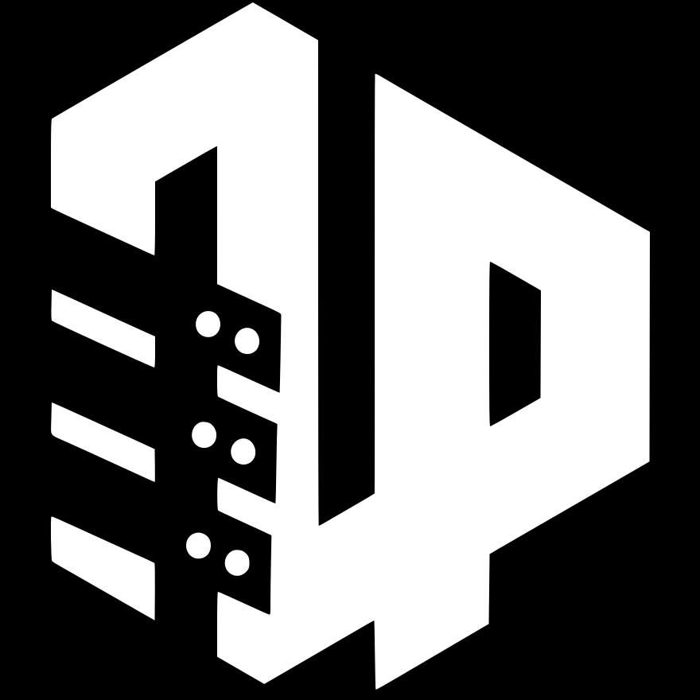</a>
</p>

<h1 align="center">elementfromgaze</h1>

<p align="center">
  Point at things with your eyes, using only the laptop's webcam.<br>
  The pointer lands on the button you look at, in any Windows app or web page, and a long blink clicks it.
</p>

<p align="center">
  <a href="LICENSE"></a>
  <a href="#the-weights"></a>
  
  
  
</p>

<p align="center">
  <b>A side project of <a href="https://infraphysics.net">InfraPhysics</a>.</b>
  How a webcam can tell where you look, and every decision measured along the way, is in the project write-up on <a href="https://infraphysics.net"><b>infraphysics.net</b></a>
</p>

<p align="center">
  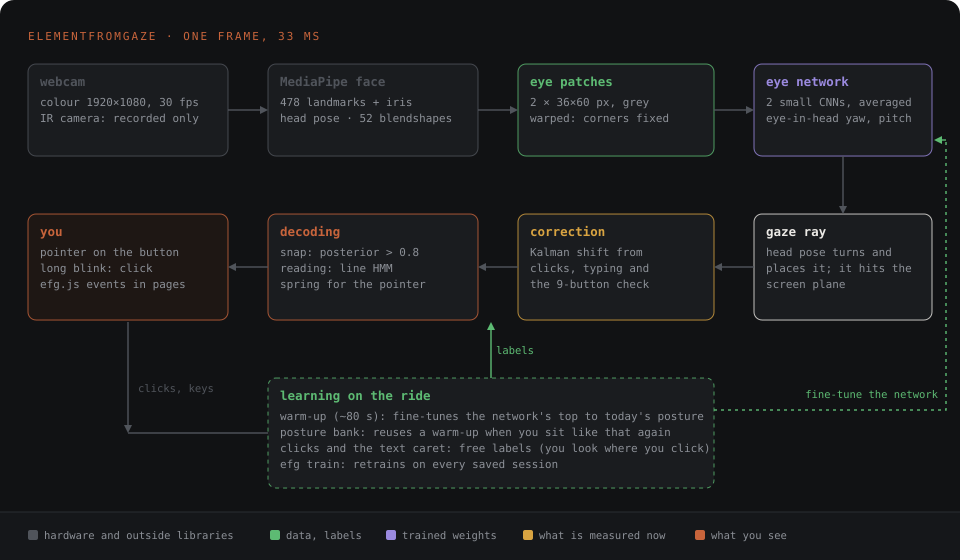
</p>

The goal is one call, **`elementFromGaze()`**: which button, line or word you are looking at, the way `document.elementFromPoint` answers for the mouse. I built it on a ThinkPad with nothing but its webcam, no infrared tracker, no GPU, and measured every piece on myself. After an 80-second warm-up it lands within about **1°** of where I look (about 1 cm on the screen), which is enough to pick a button 2 to 3° tall with your eyes and not enough for the 25-pixel menus of Windows. Both halves of that sentence are in the [chart below](#how-big-must-a-button-be).

**Try it without installing anything: [the live demo](https://infraphysics.net/playgrounds/5530619/gaze-live)** runs the strangers' base in your browser (MediaPipe for the web, the eye networks in plain JavaScript), calibrates on your face in 80 seconds and then lights up buttons for you to pick by looking. The camera image never leaves the tab.

---

## TL;DR

- **Webcam only, CPU only, offline.** About 13 ms per frame on a laptop, nothing leaves the machine.
- **About 1° after a warm-up** (0.89° in the button test, 1.46° following a moving ring). Paid infrared trackers do 0.3 to 0.5°; published webcam methods without calibration, 4 to 5°.
- **Learns while you use it.** Every mouse click and every typed character is a free label: you look where you click. A short warm-up each session adapts it to how you sit.
- **Three ways to use it**: drive the desktop (`control`), a gaze dot for any purpose (`dot`), or gaze events in your own web pages (`efg.js`).
- **Two sets of weights**: mine, and a base trained on 10 strangers that anyone can start from.

```powershell
git clone https://github.com/yago-mendoza/elementfromgaze; cd elementfromgaze
py -3.13 -m venv .venv
.\.venv\Scripts\python -m pip install --only-binary :all: -e .
.\.venv\Scripts\python -m elementfromgaze app
```

<p align="center">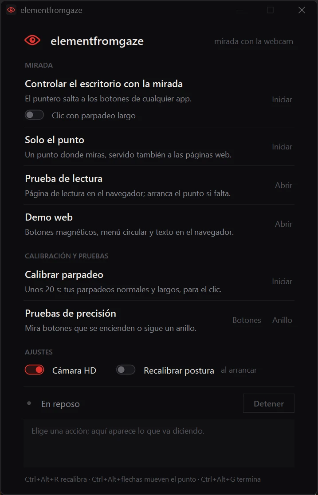<br><sub><code>app</code>: every mode one click away, also from the tray. The first run downloads the face model and the base weights and starts with the warm-up.</sub></p>

The first time, it needs no calibration session: the generic base plus the 80-second warm-up is enough to start. Run `gesture` once before using the blink click.

## What you see

<table>
  <tr>
    <td width="50%">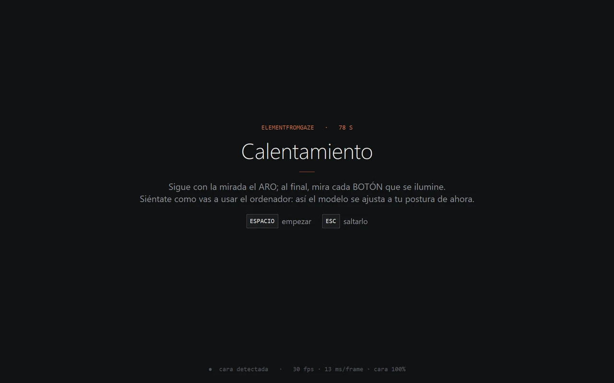<br><sub><b>Warm-up, 78 s.</b> Every session starts here: sit as you will work, follow the ring.</sub></td>
    <td width="50%">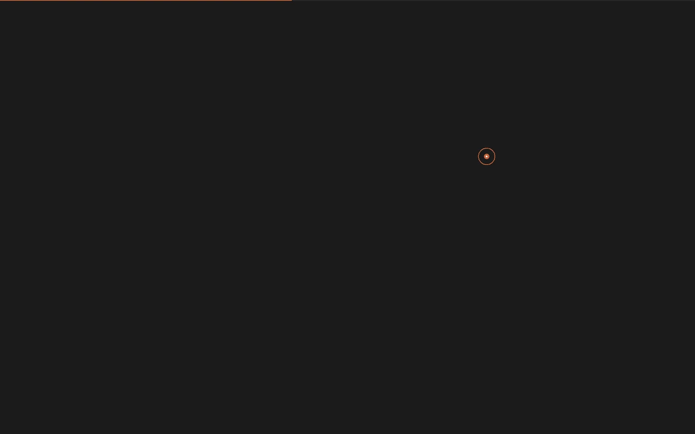<br><sub><b>Fixation target.</b> A copper disc with a pinhole, and a ring that closes onto it while the eye settles. The hairline on top is the progress.</sub></td>
  </tr>
  <tr>
    <td>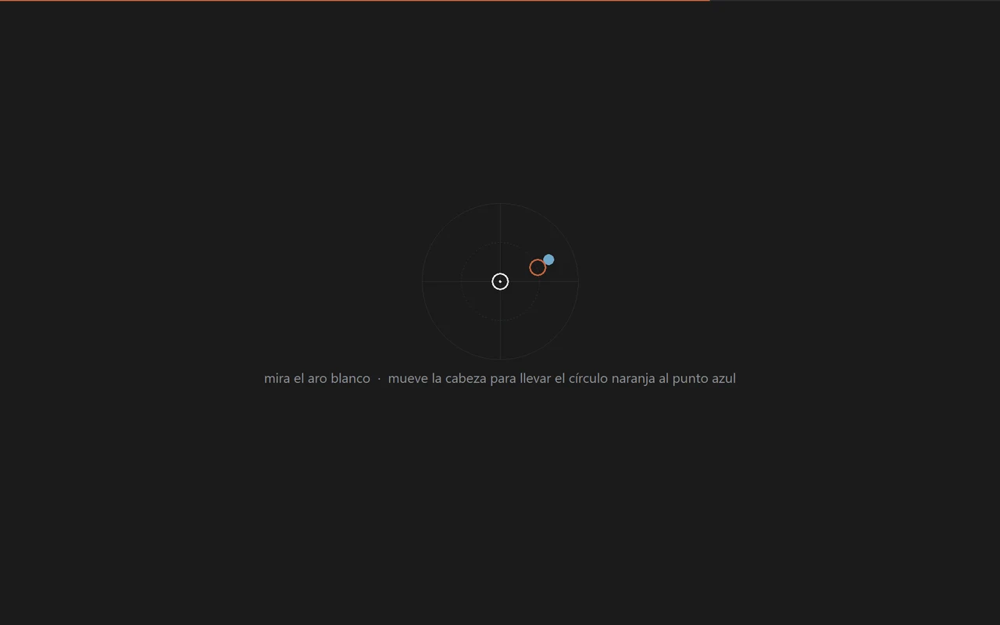<br><sub><b>Head turn.</b> Keep looking at the ring and steer the copper circle (your nose) onto the blue dot. Teaches the network that turning the head is not looking elsewhere.</sub></td>
    <td>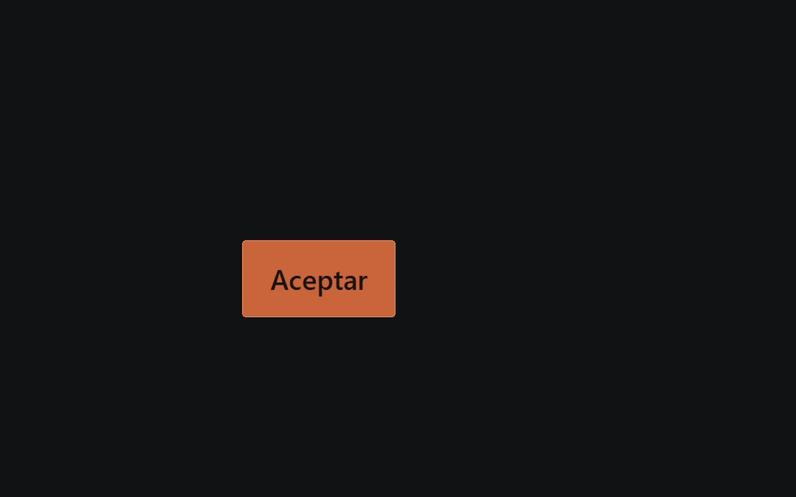<br><sub><b>Nine buttons.</b> The warm-up ends by measuring what is still off on real fixations, which seeds the correction.</sub></td>
  </tr>
  <tr>
    <td>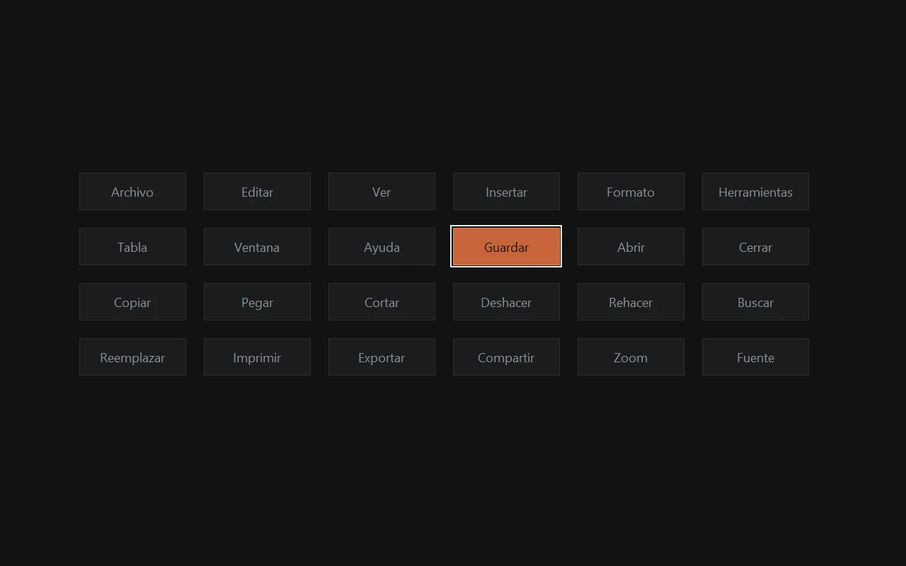<br><sub><b><code>targets</code>.</b> A lit button among many, shrinking: measures which sizes you can pick by gaze.</sub></td>
    <td>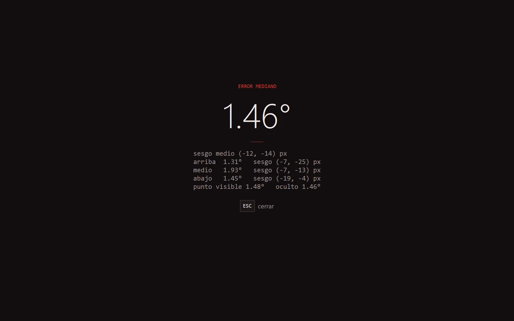<br><sub><b><code>track</code> result.</b> A real run: 1.46° median while following a moving ring, by screen band.</sub></td>
  </tr>
  <tr>
    <td>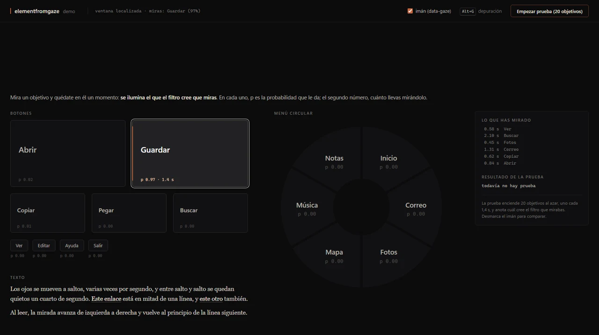<br><sub><b><code>/demo</code>.</b> Magnetic buttons in a page: the one you look at lights up, with its probability and how long you have looked.</sub></td>
    <td>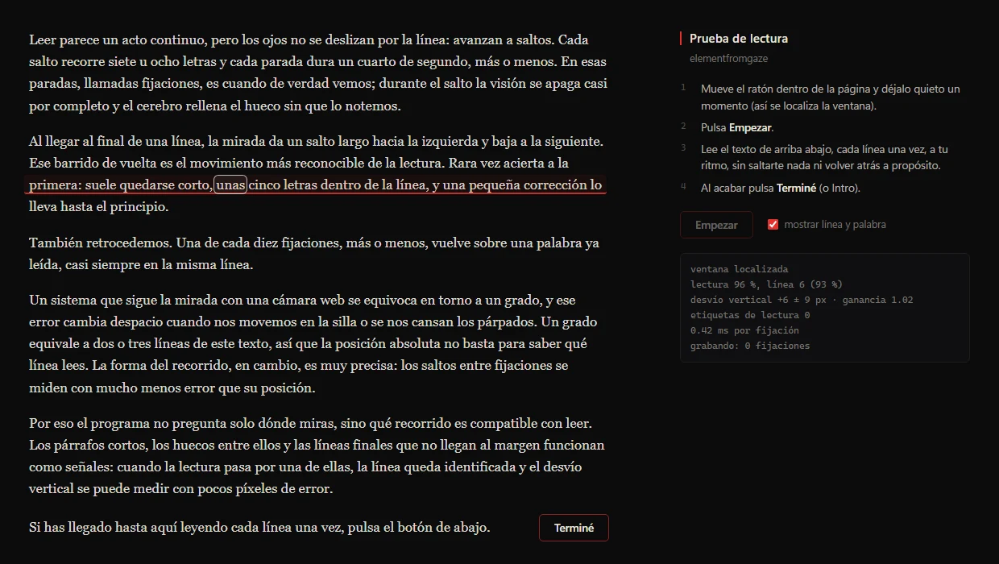<br><sub><b><code>/read</code>.</b> Read the text once; the page underlines the line it thinks you are on and scores it at the end.</sub></td>
  </tr>
</table>

<sub>Screens drawn by the app's own code with a simulated gaze state (the web pages) and without the camera preview that sits at the bottom of the real calibration screens.</sub>

## Which mode do I want

| You want to | Run | What happens |
|---|---|---|
| Use it without typing commands | `app` | A small window and a tray icon with every action below as a button. |
| Move the pointer with your eyes in any app | `control --dot` | The pointer snaps to the button you look at (Windows UI Automation reads every app's buttons). |
| Also click with your eyes | `control --dot --click` | Close both eyes a little longer than a blink (0.8 s for me) to click. Record your blinks once with `gesture`. |
| See where it thinks you look | `dot` | A copper dot over the whole screen. Learns from your clicks and typing. |
| Use gaze in a web page | `dot --serve` | Streams gaze to `http://127.0.0.1:8770`; load `efg.js` in any page. Demos at `/demo` and `/read`. |
| Know how good it is today | `track`, `targets` | Follow a ring, or pick lit buttons; both log the error. |

Every command runs as `python -m elementfromgaze <command>` from the venv. Add `--hd` before the command for the 1920×1080 colour camera (more eye detail; the mode I use). Keys while it runs: **Ctrl+Alt+R** recalibrate (~45 s), **Ctrl+Alt+arrows** nudge the dot, **Ctrl+Alt+G** quit.

<details>
<summary><b>All commands and options</b></summary>

| Command | Options | What it is for |
|---|---|---|
| `app` | | The launcher window and tray icon. |
| `control` | `--click` `--dot` `--serve` `--rewarm` `--no-warmup` | Desktop control: snap to buttons, optional long-blink click, optional dot and web stream. |
| `dot` | `--serve` `--no-dot` `--no-learn` `--rewarm` `--no-warmup` | The gaze dot; `--serve` for web pages; `--no-learn` ignores clicks and typing. |
| `gesture` | | 25 s: records your normal and long blinks and sets the click threshold so normal blinks never click. |
| `calibrate` | `--tag` `--note` | A full calibration session (~40 s); kept, and the model retrains on all sessions. |
| `train` | | Retrain on every saved session. |
| `track` | `--rewarm` `--no-warmup` `--note` | Test: follow a moving ring; the live dot is shown or hidden at times. Logs median error by screen band. |
| `targets` | `--show` `--rewarm` `--no-warmup` `--note` | Test: look at lit buttons of shrinking size. Logs which sizes work. |
| `weights` | `generic` `author` | Download the published weights (below). The generic base is fetched by itself the first time anyway. |
| `probe` | | Camera and face check, prints speed. |
| `ir` | | Live view of the laptop's infrared camera. |
| `follow`, `edges`, `motion`, `eval`, `bench` | | Extra calibration protocols and benchmarks used during development. |
| `generic` | `prepare <dir>`, `build` | Developer: rebuild the strangers' base from MPIIFaceGaze. |

Global flags: `--hd` (colour camera at 1920×1080), `--no-train` (record without retraining).
</details>

## How it works

| Part | What it does | Where | Measured |
|---|---|---|---|
| **Camera** | Colour webcam, 1920×1080 at 30 fps (DirectShow, MJPG). Warns when dim light drops it to 16 fps. | `camera.py` | Half the frames made the dot visibly jumpy (2026-11-07). |
| **Face** | MediaPipe Face Landmarker: 478 landmarks with the irises, the head's 4×4 pose, 52 blendshapes (blinks). | `features.py` | |
| **Eye patches** | Each eye cut out and warped so its two corners sit at fixed points: removes roll, distance and most of the head's tilt. | `appearance.py` | Beat the classic 3D normalisation of the gaze literature here (eye-corner tilt follows head pitch at ~0.3°/°). |
| **Eye network** | Two small CNNs (113k parameters each) averaged; they output the eye's yaw and pitch inside the head. | `appearance.py` | ~5 ms per frame. |
| **Gaze ray** | The head pose rotates and places that direction; the ray hits the screen plane. Physics, not a black box: turning the head does not drag the dot. | `geometry.py` | |
| **Warm-up** | ~80 s at the start of a session: pursuits, corners, a guided head turn and nine buttons. Fine-tunes the top of the network to today's posture and light. | `track.py` | In a posture never calibrated: 4.3° before, 1.1 to 1.2° after. Every part ablated; each helps. |
| **Posture bank** | Keeps every warm-up with the posture it was fitted to and switches when you sit like that again. | `track.py` | |
| **Correction** | A Kalman filter on a screen-wide shift, fed only by external labels: clicks, the text caret, the nine-button check. Many clicks in one spot cannot rotate the rest of the screen. | `adapt.py`, `implicit.py` | Button test replayed offline: 1.74° to 1.14° with the check's correction. |
| **Snapping** | Bayesian posterior over the clickable elements of any app (UI Automation) or page (`data-gaze`); snaps above 0.8, releases below 0.4. Two neighbours it cannot tell apart split the posterior and nothing snaps. | `desktop.py`, `efg.js` | |
| **Click** | A long blink: both eyes closed past a threshold set from your own blinks. The button is frozen as the lids start to close, since closing lids drag the estimate down. | `desktop.py`, `gesture.py` | My blinks: normal up to 0.47 s, long from 1.19 s; threshold 0.8 s. |
| **Reading** | In pages, a filter over fixations that knows how reading moves (left to right, return sweeps) to say which line and word you are on. | `efg.js` | Being tuned now. |
| **Retraining** | `train` refits on every saved session, clicks and warm-ups included. | `app.py` | Cold, close posture: 5.75° to 2.43° after training on everyday use. |

### How big must a button be

<p align="center">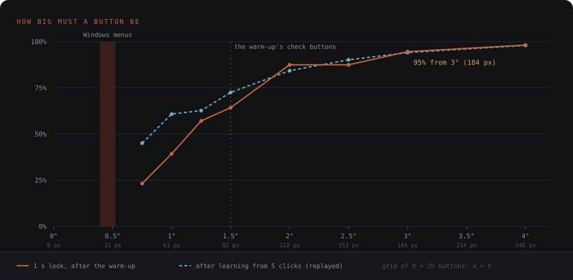</p>

From one `targets` run (56 trials, after the warm-up). A 1° error spread over a grid means a button needs to be about **2° tall (120 px)** to be picked nine times in ten, and 3° for 95%. Windows menus are a fifth of that, which is why desktop control works on big buttons and the taskbar but not yet on dense toolbars; a magnifier that enlarges the region you look at is the planned answer.

### Compared with other trackers

| | Accuracy | How | Source |
|---|---|---|---|
| Tobii Pro Spectrum | 0.30° median (chin rest), 0.43° head free | infrared, 1200 Hz | [Tobii](https://www.tobii.com/products/eye-trackers/screen-based/tobii-pro-spectrum) |
| EyeLink 1000 Plus | 0.25 to 0.50° typical | infrared, up to 2000 Hz | [SR Research](https://www.sr-research.com/eyelink-1000-plus-technical-specifications/) |
| Gazepoint GP3 | 0.5 to 1° | infrared, 60 Hz, $985 | [Gazepoint](https://www.gazept.com/product/gazepoint-gp3-eye-tracker/) |
| Tobii Eye Tracker 5 | not published | infrared, gaming, 279 EUR | [Tobii](https://gaming.tobii.com/product/eye-tracker-5/) |
| **elementfromgaze** | **~1° after warm-up** (0.89° button test, 1.46° moving ring) | **webcam**, one person, calibrated | this repo |
| WebGazer | 4.17° (lab, chin rest) | webcam, learns from clicks | [Papoutsaki et al. 2016](https://jeffhuang.com/papers/WebGazer_IJCAI16.pdf) |
| MPIIFaceGaze full-face CNN | 4.8° | webcam, people it never saw, no calibration | [Zhang et al. 2017](https://arxiv.org/abs/1611.08860) |

The rows are not one benchmark: protocols differ, and mine is one person calibrating on his own laptop. What it does show is the gap the infrared hardware buys (below), and how much a person-specific network plus a warm-up closes it on a webcam.

### Infrared, and why it is not in the live path

Paid trackers shine infrared LEDs at the eye and find two things in the image: the pupil and the glint, the LED's reflection on the cornea. The vector between them follows the eye's rotation, and a calibration absorbs the angle between the eye's optical axis and where the fovea actually points (4 to 5°, different for everyone). That is how they reach 0.3°.

This laptop has an infrared camera for Windows Hello, and `ir` reads it (640×360, ~7 lit frames per second; the glint is visible). Fusing it with the colour camera was measured and **lost**: 1.62° colour alone against 1.81° fused, after the warm-up. Without a warm-up, infrared alone is the most robust to posture and light (3.15° against 4.26°), so it is kept for a future no-warm-up mode. Calibration sessions still record it.

## The weights

| Set | What it is | Size | License | Get it |
|---|---|---|---|---|
| `generic` | Two eye networks trained on 10 strangers of [MPIIFaceGaze](https://arxiv.org/abs/1611.08860) with their true 3D gaze, plus the strangers' eye patches every warm-up replays. Where a new user starts. | 21 MB | CC BY-NC-SA 4.0 (the dataset's) | fetched by itself on first run, or `weights generic` |
| `author` | My two eye networks, trained on ~30 of my own sessions. Only the networks: no images, no face features, no sessions. | 0.9 MB | CC BY 4.0 | `weights author` |

**Starting as a new user.** With no model of your own, the first run loads the generic base, the warm-up fits your screen's geometry and fine-tunes for 16 rounds while replaying the strangers. Measured with me playing a new user (a network that never saw me plus my 80-second warm-up): **1.80° median**, against 1.34° for my own network. On five people of the dataset it never saw, calibrated with 150 images each, the error is 4.7 to 4.8°: their photos are harder than a laptop webcam at arm's length. A second real person has not been tested yet.

Both files are Python pickles, and a pickle can run code when it loads: `weights` checks each file's SHA-256 against the one in `weights.py` and refuses anything else.

## Web: `efg.js`

Run `dot --serve` (or `control --serve`), then in any page:

```html
<script src="http://127.0.0.1:8770/efg.js" data-show></script>
<button data-gaze>Buy</button>          <!-- magnetic: the pointer snaps onto it -->
<script>
  efg.elementFromGaze()                  // {element, p, dwellMs, attractor} | null
  efg.reading()                          // {line, word, ...} while reading text
  addEventListener("efgfixation", e => {})  // also gazeenter, gazeleave, gazedwell on elements
</script>
```

## Measured and rejected

Kept here so nobody retries them blind; the details are in the commit messages.

| Idea | Result |
|---|---|
| Fusing the infrared camera | 1.81° against 1.62° colour alone |
| Pretraining on MPIIGaze for the personal model | 3D normalisation lost to the 2D corner warp |
| Larger eye crops, calibration-aware training, change-point correction | no gain |
| Meta-learning (Reptile) for faster warm-ups | tie |
| Synthetic postures by rotating the camera | no information: the patch changed by 0.35/255 |
| A fixation-physics loss on unlabelled video | the outputs collapsed |
| One ray per eye, fused by confidence | mixed: better cold, slightly worse warmed |
| Head pose as an extra network input | tie |
| Clicking by squinting | MediaPipe's squint score went down when I squinted (0.31 to 0.11) |

## Privacy

Everything runs on the machine. Sessions, camera frames, models and logs live in `data/`, which git ignores and nothing uploads. The text-caret hook records positions, never keys. The published weights contain networks only.

## Status and roadmap

Experimental, Windows only, built and measured on one person.

- [x] Core, head-pose robustness, appearance network, warm-up, posture bank
- [x] Learning from clicks and typing, snapping to UI elements, reading layer, desktop control, long-blink click
- [x] A base for new users (`generic`)
- [ ] A magnifier for small targets: look at a region, it enlarges, pick inside
- [ ] Automatic periodic retraining
- [ ] A second and third person; a base trained on many more people, with and without glasses
- [x] [A live demo in the browser](https://infraphysics.net/playgrounds/5530619/gaze-live): the eye networks hand-ported to JavaScript (`docs/export_web.py` writes their weights; same angles as PyTorch to 0.02°), and a light calibration (13 numbers per network, by least squares) that matched the full warm-up on my held-out sessions, 2.12° mean

## License

Code: [MIT](LICENSE). Weights: `author` CC BY 4.0; `generic` CC BY-NC-SA 4.0, because MPIIFaceGaze is (Zhang, Sugano, Fritz and Bulling, *It's Written All Over Your Face: Full-Face Appearance-Based Gaze Estimation*, CVPRW 2017).
